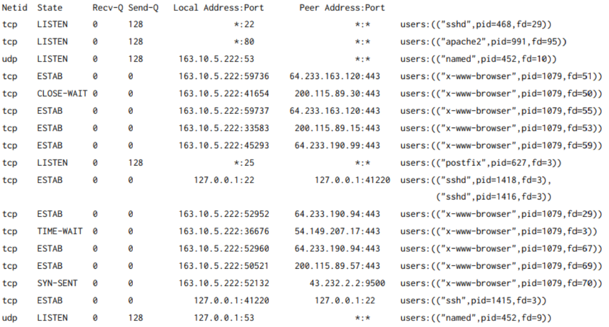
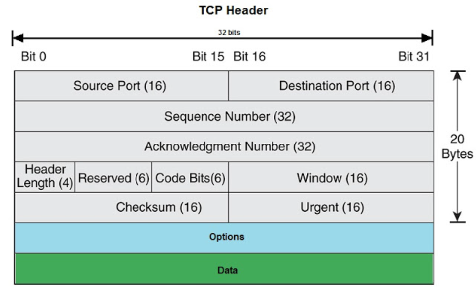
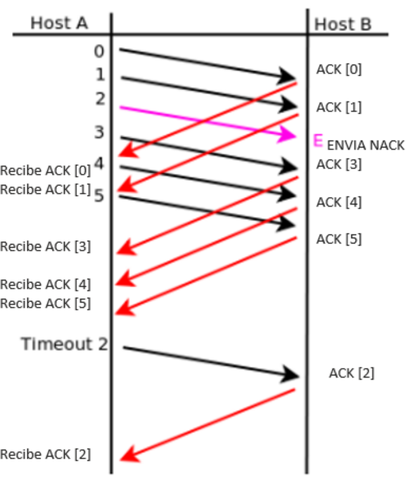
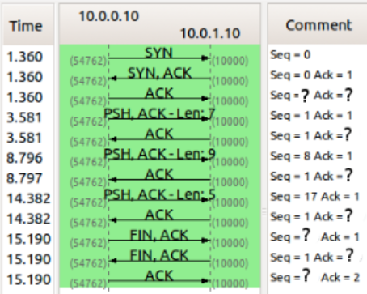

- Se encarga de comunicar procesos de la capa de aplicación
- Puede implementarse con TCP o UDP
## Puertos
- Son numeros de 0 a 65535 que identifican a un proceso determinado de una aplicacion de ambos lados de la comunicacion TCP o UDP
- En TCP los puertos 0 a 1013 estan reservados y no se pueden usar como emisor de una conexion TCP, a no ser que se use el **sudo**
## Comando SS

- SS muestra informacion de todas las conexiones TCP y UDP actuales en la maquina
	- **ss -l** : Sockets que estan escuchando
	- **ss -a** : Todos los sockets
	- **ss -t** : Sockets TCP
	- **ss -u** : Sockets UDP
	- **ss -t -l** : Sockets TCP esperando conexiones
	- **ss -u -l** : Sockets UDP esperando comunicaciones
	

- Cuando tenemos LISTEN en la columna state, ese host esta escuchando TCP en la IP y el puerto en esa fila
- Cuando tenemos UNCONN en la columna state, ese host esta escuchando UDP en la IP y puerto indicados
- Una comunicacion se identifica (clave primario) por:
	- IP origen
	- IP destino
	- Puerto origen
	- Puerto destino
	- Protocolo (TCP o UDP). NO puede tener 2 filas con misma IP local:puerto, misma IP remota:puerto y mismo protocolo
- Hay 8 conexiones establecidas a pesar de que hayan 9 rows con state ESTAB. Esto es porque 127.0.0.1:22 con 127.0.0.1:412220 aparece 2 veces
- El asterisco en la IP significa que una vez se establezca la conexion puede elegir cualquier IP. Lo mismo el asterisco en los puertos
- En general, los que estan estado LISTEN son servidores y los que fueron iniciados desde el localhost son clientes
- Podemos inferir que protocolos esta usando cada conexion en base a los puertos. Por ejemplo:
	- 443 -> HTTPS
	- 53: -> DNS
	- 22 -> SSH
	- 25 -> SMTP
## Unicast, Multicast, Broadcast Anycast
- **Unicast**: UN emisor encia un mensaje a UN receptor
- **Multicast**: Un emisor envia un mensaje a MUCHOS receptores a la vez
- **Broadcast**: Un emisor envia un mensaje a TODOS los receptores de la red a la vez
- **Anycast**: una IP se asigna a muchos dispositivos y un mensaje se envia al mas cercano de estos dispositivos
## TCP
### Segmento TCP

| Campo              |                                                                           Uso                                                                            |
| :----------------- | :------------------------------------------------------------------------------------------------------------------------------------------------------: |
| Puerto origen      |                                                           N° de puerto de la aplicacion origen                                                           |
| Puerto destino     |                                                          N° de puerto de la aplicacion destino                                                           |
| N° secuencia       |                                                             N° de byte en el segmento local                                                              |
| N° ack             |                                                                Siguiente Sequence Number                                                                 |
| Header de longitud |                                                    Longitud total de segmento, header + option + data                                                    |
| Flags              |                                                         Existen varios tipos con distintos usos                                                          |
| Checksum           |                      Valor computado a partir de la data que el receptor tambien computa para asegurar que el segmento llego entero                      |
| Urgent Pointer     |                                         Dice donde empieza una parte de la data que requiere atencion inmediata                                          |
| Options            | Opciones operativas de control y manejo de la conexion, por ejemplo Maximum Segment Size (tamaño maximo de segmento que puede recibir una de las partes) |
| Datos              |                                                              Los datos en cuestion a enviar                                                              |
- Los flags son:
	- **URG**: El Urgent Pointer debe ser priorizado
	- **ACK**: A recibio correctamente el ultimo dato que B le envio
	- **PSH**: Los datos del segmento deben entregarse de inmediato al receptor, sin perder tiempo esperando que se almacenen en el buffer
	- **RST**: Terminar la conexion cuando aparece un problema. Si se recibe al intentar inciar una conexion signidica que no hay proceso del host receptor escuchando en el puerto indicado
	- **SYN**: Iniciar una conexion TCP, sincronizado los Sequence Numbers iniciales entre remitente y receptor
	- **FIN**: la parte que envia el segmento termino el envio y quiere cerrar la conexion. Cuando la parte opuesta tambien envia FIN se cierra la conexion
### Three Way Handshake (SYN > ACK + ACK > SYN) 
Es el proceso a traves del cual se establece una conexion TCP entre 2 partes. Consiste de 3 pasos como su nombre lo indica:
1. El emisor envia un segmento al reptor:
	1. Sin datos
	2. Con Sequence Number aleatorio (ISN) y con flag SYN = 1
2. El receptor responde al emisor con un segmento
	1. Sin datos
	2. Con Sequence Number aleatorio (ISN) y con flags SYN = 1 y ACK = 1
	3. Con Acknowledgment Number = ISN que envio el emisor + 1
3. El emisor le responde al receptor con un segmento
	1. Sin datos
	2. Con flags ACK = 1 y SYN = 0, indicando que la conexion fue establecida correctamente
**Nota**: Si luego del paso 1 el proceso receptor (IP + puerto que el emisor eligio) no esta escuchando trafico TCP, se recibe un segmento vacio con flags RST = 1 y ACK = 1 
### Terminacion de una conexion TCP
Es el proceso a traves del cual se cierra una conexion TCP entre 2 partes. Consiste en 4 pasos
1. El emisor que quiere cerrar la conexion envia un segmento a la otra parte
	1. Sin datos
	2. Con flag FIN = 1
2. El receptor responde al emisor con un segmento
	1. Sin datos
	2. Con flag ACK = 1
3. El receptor envia otro segmento mas
	1. Sin datos
	2. Con flag FIN = 1
4. El emisor reponde al receptor con un ultimo segmento
	1. Sin datos
	2. Con flag ACK = 1
**Nota**: Si luego del paso 2 el proceso receptor tiene datos para enviar, los enviara todos, y luego enviara el segmento con FIN  = 1 (paso 3)
### Tipos de estado TCP
|    Estado    | Significado                                                                                          |
| :----------: | ---------------------------------------------------------------------------------------------------- |
|    LISTEN    | Se esta preparando una solicitud de conexion en un puerto determinado                                |
|   SYN-SENT   | El cliente envio la solicitud de conexion                                                            |
| SYN-RECEIVED | El servidor recibio la solicitud y envio SYN = 1                                                     |
| ESTABLISHED  | Conexion establecida, ambos pueden enviarse datos                                                    |
|  FIN-WAIT-1  | Una de las partes envio un segmento con FIN = 1 y espera un ACK de la otra parte                     |
|  FIN-WAIT-2  | La otra parte recibio ese ACK                                                                        |
|  CLOSE-WAIT  | La otra parte puede seguir enviando datos hasta recibir un FIN = 1                                   |
|   CLOSING    | La otra parte recibe un FIN = 1, ya no puede enviar datos                                            |
|   LAST-ACK   | La otra aprte espera el ultimo ACK                                                                   |
|  TIME-WAIT   | La otra parte (que ya habia cerrado la conexion) responde con ACK y espera que el servidor lo reciba |
|    CLOSED    | La conexion se cerro de ambos lados                                                                  |
### Control de flujo
- Consiste en que cada una de las partes le envia a la otra solo tanto como la otra parte pueda manejar, para evitar desbordarlo
- Lo activa el receptor obligatoriamente, no puede omitirlo
	- Lo hace utilizando una Ventana de Recepcion, la cual indica que el emisor solo prodra enviarle como maximo lo que indique esa ventana por cada segmento. Cuando el buffer del receptor se llena, su VR pasa a valer 0
- El control de flujo dura activo hasta que se vacie el buffer de recepcion. Tambien se puede ajustar la ventana de recepcion dinamicamente
### Selective Repeat
- Solo los segmentos erroneos o que no se perdieron se retransmitiran. Un tamaño de ventana = N significa que el emisor puede enviar como maximo N segmentos seguidos sin esperar respuesta
- Posee una restriccion: Tamaño de ventana <= (cantidad total de segmentos enviados / 2)
- Ejemplo:
	 
### Control de congestion
- El control de congestion lo activa el emisor cuando ocurre una o mas de estas situaciones
	- Hay mucha perdida de paquetes
	- El RTT empieza a aumentar
	- Se recibe una Notificacion Explicita de Congestion
- Intenta evitar que la red en general se satura
- **Slow start**: Se empieza con una ventana de congestión pequeña y va aumentando exponencialmente cada vez que se recibe un ACK hasta el momento en que se detecta congestiona. Ahi, se pasa a Congestion-Avoidance
- **Congestion-Avoidance**: Se reinicia la ventana de congestion y ahora crece linealmente en vez de exponencialmente
### Ejemplo de conexion TCP exitosa

- Seq = 0 (3WH)
- Seq = 0, ACK = 1 (3WH)
- Seq = 1, ACK = 1 (3WH)
- Seq = 1, ACK = 1
- Seq = 1, ACK = 8 (Seq 1 + len 7 = 8)
- Seq = 8, ACK  = 1
- Seq = 1, ACK 17 (Seq 8 + len 9 = 17)
- Seq = 17, ACK = 1
- Seq = 1, ACK = 22 (Seq 17 + len 5 = 22)
- Seq = 22, ACK = 1
- Seq = 1, ACK = 23 (Seq 22 + len 1 = 23)
- Seq = 23, ACK = 2

## Datagrama UDP

| Campo          |                                                    Uso                                                     |
| :------------- | :--------------------------------------------------------------------------------------------------------: |
| Puerto origen  |                 N° de puerto de la apliacacion origen. Puede omitirse, a diferencia de TCP                 |
| Puerto destino |                                   N° de puerto de la apliacacion destino                                   |
| Longitud       |                                        Lonigtud del header + datos                                         |
| Checksum       | Valor computado a partir de la data que el receptor tambien computa para asegurar que la data llego entera |
| Data           |                                       Los datos en cuestion a enviar                                       |
- El checksum es opcional, no obligatorio como el segmento TCP
- El puerto origen es opcional, podemos omitirlo en caso que no nos interese recibir una respuesta
- Lenght tiene un tamaño maximo mas pequeño que en el segmento TCP
## TCP vs UDP

|                                                |                                                    TCP                                                    | UDP                                                                                              |
| :--------------------------------------------- | :-------------------------------------------------------------------------------------------------------: | ------------------------------------------------------------------------------------------------ |
| Confiabilidad                                  |                   Es confiable, garantiza que la informacion llegue completa y en orden                   | No es confiable, no garantiza que los datos llegan y si llegan no garantiza que lleguen en orden |
| Multiplexacion                                 |                   La provee por medio del establecimiento de conexion y de los puertos                    | La provee por medio de los puertos                                                               |
| Orientacion a la conexion                      |                       Es orientado a la conexion, siempre la establece mediante S3V                       | No establece conexion                                                                            |
| Control de congestion                          |                               Lo implementa de forma adaptativa y dinamica                                | No lo implementa                                                                                 |
| Uso de puertos                                 | Socket = definido por cada lado de la conexion. Por cada Socket solo 2 procesos pueden intercambiar datos | Socket = N° port destino + IP destino. Por un mismo Socket muchos clientes pueden enviar datos   |
| Eficiencia                                     |                                   Gran overhead debido a su complejidad                                   | Muy simple, eficiente y rapido                                                                   |
| PDU                                            |                                                 Segmento                                                  | Datagrama                                                                                        |
| Broadcast                                      |                                               No lo soporta                                               | Lo soporta                                                                                       |
| Multicast                                      |                                               No lo soporta                                               | Lo soporta                                                                                       |
| No hay proceso escuchando en el puerto elegido |                                Responde con un segmento vacio con RST = 1                                 | Responde con un datagrama especial ICMP Port Unreachable                                         |
| ICMP                                           |                                                No usa ICMP                                                | Usa ICMP como control de errores                                                                 |
